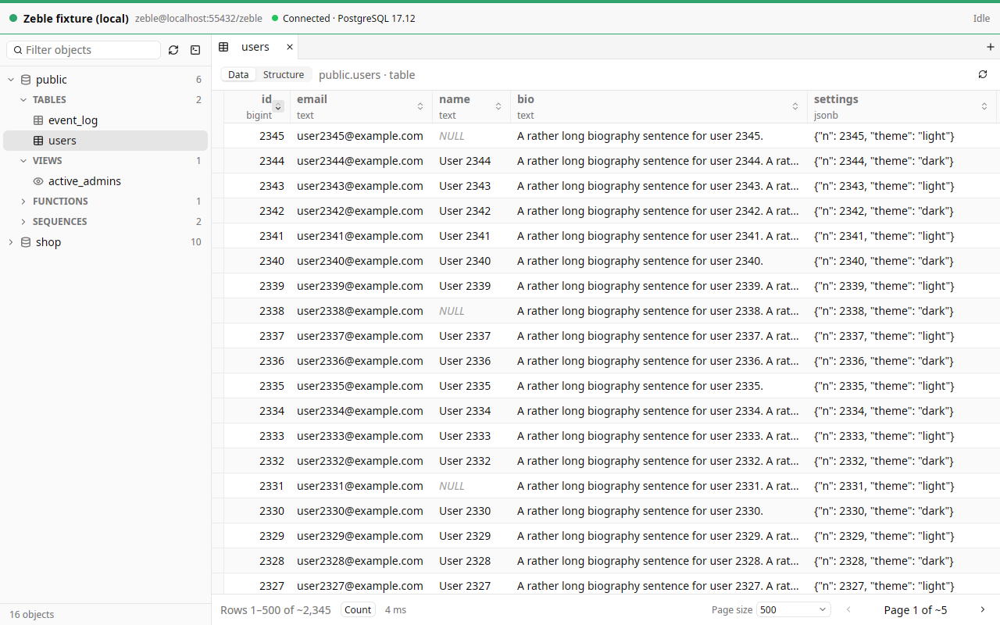

# Zeble

A PostgreSQL browser for the desktop, in the spirit of TablePlus and Postico, built with
Rust, [GPUI](https://www.gpui.rs) and [gpui-kit](https://github.com/longbridge/gpui-kit).



## What it does

- **Saved connections**: add, edit, duplicate and delete them, and drag to reorder. You can paste a
  `postgres://` URL to fill in the form, test a connection, and give it a colour tag and a
  per-connection read-only switch. Double-click a connection to open it in its own window.
- **Connection window**
  - **Top bar**: connection state, server version, what is running and for how long, a Cancel
    button and a Reconnect button.
  - **Sidebar**: schemas with their tables, views, materialized views, foreign tables, functions,
    procedures, sequences and types (enum, domain, composite, range), plus a filter box and
    refresh (⌘R).
  - **Tabs**: closable (⌘W) and reorderable by dragging.
- **Table and view tabs**
  - **Data**: a virtualized grid with sticky column headers that show each column's type.
    Click a header to sort on the server (ascending, descending, off).
  - **Paging**: pages of 100, 500 (the default), 1000 or 5000 rows, with an estimated total
    and an exact Count button.
  - **Cells**: NULL is shown dimmed and long values are truncated. ⌘C copies a cell, row or column.
  - **Structure**: columns, indexes, constraints, and the view definition for views.
- **Function, sequence and type tabs**: properties and the SQL definition.
- **Query tabs (⌘T)**
  - An SQL editor with syntax highlighting above a results grid, with a draggable divider
    between them.
  - ⌘↵ runs the statement at the cursor (tinted in the editor) or the selection. ⌘⇧↵ runs
    everything. Statements run one at a time with their own timing and autocommit unless you
    `BEGIN`.
  - Each tab has its own connection, so transactions and `SET` carry over from one run to the
    next. An open transaction is flagged in the tab, and closing the tab or window asks first,
    then rolls it back.
  - Errors are underlined in the editor. Results are capped at 10,000 rows.
  - Query tabs are saved per connection and come back the next time you open it.

Editing table data from the grid is not implemented yet.

## Build and run

You need Rust (stable). On macOS you need the Xcode command line tools. On Linux, install the
GPUI dependencies (Debian/Ubuntu shown):

```sh
sudo apt-get install build-essential pkg-config clang libxkbcommon-dev libxkbcommon-x11-dev \
  libwayland-dev libx11-xcb-dev libxcb1-dev libvulkan-dev libfontconfig-dev libfreetype-dev libssl-dev
```

```sh
cargo run --release -p zeble-app      # binary: target/release/zeble
```

Saved connections are stored in `connections.json` in the platform config folder:
`~/Library/Application Support/zeble` on macOS and `~/.config/zeble` on Linux. Set
`ZEBLE_DATA_DIR` to use a different folder. **Passwords are stored in plain text** in that file,
which is written with mode `0600`.

## Development

```
crates/zeble-core   connections, Postgres access, catalog queries, SQL splitting (no UI)
crates/zeble-app    the GPUI application
fixtures/seed.sql   a schema with every object type the app shows
```

```sh
docker compose up -d        # Postgres 17 on localhost:55432 (user/password/db: zeble)
cargo test --workspace      # integration tests skip themselves when the DB is down
```

To test against a different server, set `ZEBLE_TEST_URL=postgres://…`.

## Known limitations

- TLS (`prefer`/`require`) does not verify the server certificate, which matches what libpq
  does for those modes. `verify-ca` and `verify-full` are treated as `require`.
- The statement splitter handles quotes, dollar-quoting and comments. It does not handle
  SQL-standard `BEGIN ATOMIC … END` function bodies, which get split at their inner semicolons.
- Keyboard hints in the UI show macOS symbols (⌘). On Linux and Windows the shortcuts use Ctrl.
